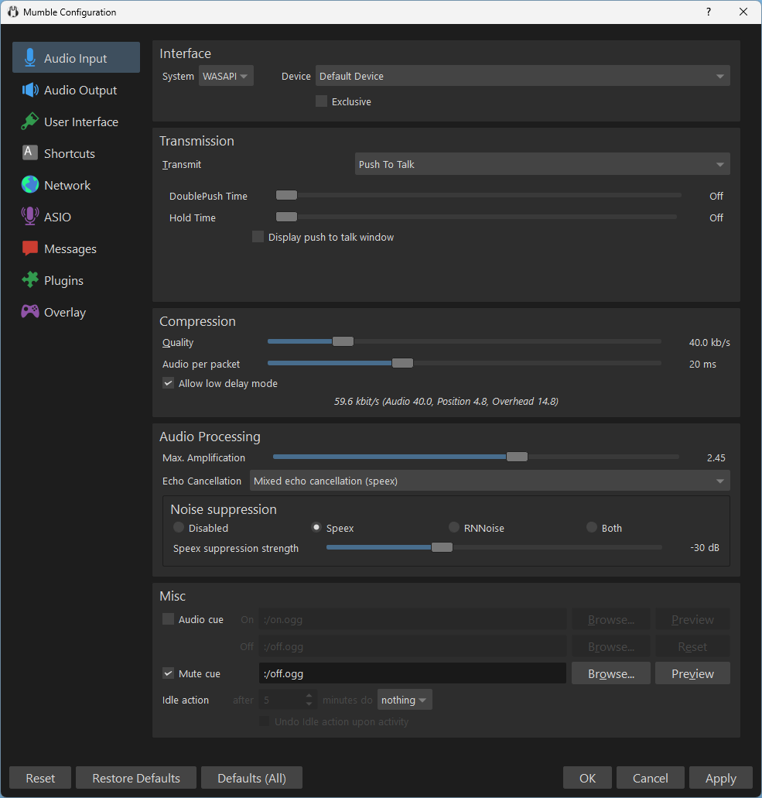
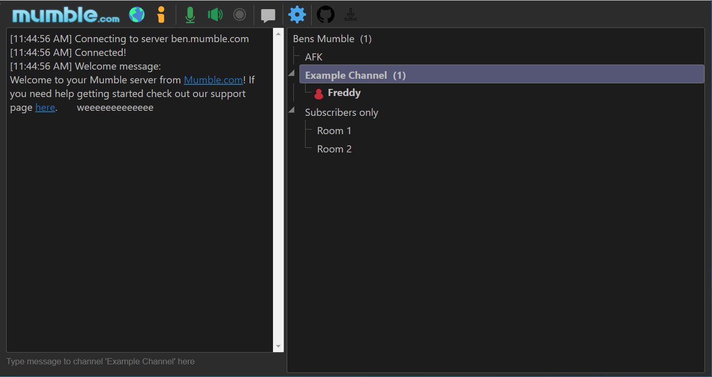

# Mumble Software

Mumble Software is Mumble Voice Chat for people who need to talk while they play or record. You join a room, push a key or let voice activity open the mic, and the other people hear you. mumble voice chat is the everyday name. mumble open source is why you can read the client and run a mumble server yourself.

The word mumble also means speaking low and unclear, or chewing with your mouth closed. That dictionary sense is not a filter in the app. The product is the voice program: encrypted team talk, positional audio for games, and a server you host when you do not want the audio on someone else's network.

The brief lists Windows, macOS, Linux, Android, and iOS. This folder has the desktop notes, an Android client, and a browser client. It does not contain an iOS project. The brief lists no price. A page that sells a "Mumble unlock" is not this software.


## Contributing

Send a voice bug with the platform, the voice mode, and whether you were on the hosted client or your own mumble server. Send a server bug with the log line and whether SuperUser had a password. Do not send that password.

`bug_report.yml`, `feature_request.yml`, and `support.yml` are the issue forms. `pr-checks.yml`, `build.yml`, `freebsd.yml`, and `code-ql.yml` are check workflows. `winget.yml` is the Windows package workflow. They describe how the desktop tree is tested. The C++ sources those workflows compile are not in this file set.

### Translating

The desktop tree keeps translations beside the client. `scripts/updatetranslations.py` is the updater for those files. The language catalogs themselves are not packed here, so the script has nothing to rewrite in this folder. A missing language in the app is a translation gap, not a broken mic.

The browser client stores strings in `loc/en.json`, `loc/de.json`, `loc/es.json`, `loc/eo.json`, and `loc/oc.json`. [loc.js](app/loc.js) is the loader the page calls. Add a string in the English file first, then the other files. A key that exists only in English shows the key, not a blank bubble.

### Writing plugins

Plugins are how a game tells Mumble Software where the player is standing, so positional audio can place voices. The plugin manual is not in this folder. A plugin is optional. Team talk works with no game attached. If a game is attached and voices still sit in the middle of your head, the plugin is not linked, not the server.

## Building

The desktop client is Qt and Opus. Building it needs the full source tree and the instructions for the branch you checked out. Those C++ files are not here, so a desktop build will not start from this folder. [mumble-version.py](mumble-version.py) looks up the git root and reads a `VERSION` line from `CMakeLists.txt` that contains `.${BUILD_NUMBER}`. That CMake file is not here, so the script raises instead of printing a version. `scripts/mumble-build-number.py` is the build-number helper next to it. `scripts/check_commit_style.py` checks commit text. None of them compile a client.

[package.json](package.json) is the browser package `mumble-web` at version `0.5.1`. `npm test` prints an error and exits 1. `npm run build` runs webpack and, if `dist/config.local.js` is missing, copies the local config. [webpack.config.js](app/webpack.config.js) is that webpack file. `dist` and the installed packages are not in this tree, so the build will not finish here. `postinstall` calls `patch-package`. Do not treat a failed build as a broken mumble server.

## Reporting issues

Use the public issue tracker of the project that owns the file. A bug in [voice.js](app/voice.js) belongs to the browser client. A bug in `java/Settings.java` belongs to the Android client. A bug in `mumble-server.ini` belongs to the desktop server. Do not file a dictionary question about the verb "mumble" as a software bug.

`dependencies.json` lists build dependencies for the desktop tree. `.backportrc.json` is the backport bot config. They do not change audio.

## Code Signing

Signed Windows and macOS builds are easier to trust than a zip with the same icon. The signature is not a server password. `scripts` in the upstream tree include a macOS signing helper that is not copied here. Download Mumble Software from the button, and check the publisher before you run an installer from anywhere else.

## Windows

After a normal install, Mumble Software is a Start Menu entry. Start the client, pick a server, and set a push-to-talk key before you join a loud room. The server on Windows is a tray icon. The log is on that icon.

### Running Mumble-Server

The server binary is `mumble-server`. Until you set a SuperUser password, SuperUser is disabled. The password bypasses channel ACLs. Keep it. The process sets the password and exits when you pass `--set-su-pw`.

```
mumble-server [--set-su-pw <password>] [--ini <inifile>] [--foreground] [--verbose]
```

`--ini` picks a file other than `mumble-server.ini`, so two instances can use two databases. `--foreground` logs to the terminal. `--verbose` adds detail. The binary is not in this folder. The flags are the ones the desktop guide documents.

## MacOS

The client is dragged from a disk image into Applications. The server is shipped separately from the client on macOS. Run it the same way as on other Unix systems, including `--set-su-pw` before you expect an admin login.

## Linux/Unix

A package from the distribution should appear in the menu. No extra client step is required after that. The mumble server is still a command, not a menu item.

#### Docker image

The desktop project points at a separate image repository for Docker. That image is not in this tree. `compose` is not how this folder starts. Use the button for the client, or the server binary from a real install, if you want a running process.

### Server configuration

[mumble-server.ini](mumble-server.ini) is the server template. The welcome text is a short HTML line that names Mumble. `port` is `64738`. `serverpassword` is empty, which means the server does not ask for a password until you set one. `bandwidth` is `558000`. `users` is `100`. Change the cap before you invite a crowd larger than that. An empty password is not the same as a secret password. Set one if the server can be reached by people you did not invite.

| Key | Template value | What it does |
| --- | --- | --- |
| port | 64738 | The server listen port |
| serverpassword | empty | No join password until you set one |
| bandwidth | 558000 | Voice bandwidth cap |
| users | 100 | How many users the template allows |

The browser client does not use 64738 as its own default. `config.js` sets the connect dialog port to `443`, because the page talks through a web socket. The address defaults to the host of the page. Those two ports are different doors. Mixing them up is the usual reason a web join fails while the desktop client works.

### OpenGL Overlay

The overlay draws the Mumble window into a game by intercepting the buffer swap. The desktop guide starts a game with `mumble-overlay` and the game name. The preload library that guide names is not in this folder. Positional audio still needs the game link. The overlay is only the on-screen list.

## Sponsors

The desktop README thanks a host that donates capacity. That thanks is not a fee and not a seat you buy. The brief lists no price for Mumble Software.

## FAQs

### Action that my user has permission for does not show up in overflow menu

On the Android client, a permission the server granted can still be missing from the overflow menu until the UI refreshes the user's rights. Leave the channel and come back before you decide the server ignored the ACL. The menu is the client. The ACL is the mumble server.

## Translations

Android strings live in resource folders that are not all copied here. The settings screens that are copied are [settings_audio.xml](xml/settings_audio.xml), `xml/settings_general.xml`, and `xml/preference_headers.xml`. Translate the string the screen shows, not the preference key. `audioInputMethod` must stay a key.

## Repository submodules

The Android client depends on a protocol library that is not in this tree. [MumlaService.java](service/MumlaService.java) extends `HumlaService`. That class will not resolve here. Treat the file as the service shape, not as a project you can compile alone.

### Notes on NDK

Native audio pieces for Android are built with the NDK. Those native sources are not in this set. A Java change to notifications does not require the NDK. A codec change does.

### Container image

The Android tree documents a container for builds. It is a build machine, not the Mumble Voice Chat server. Do not point players at it.

## License

`LICENSE` is the BSD-style license from the desktop tree. Copyright is The Mumble Developers. The file names `license@mumble.info` for license questions. That address is the license contact printed in the file. It is not a support mailbox this page invented. The placeholder in INFO.txt is `support@mumble-software.com`, and the brief has no support email.

`package.json` says the browser package is ISC. The Android gradle header is GPL-3.0. This folder keeps one license file, the desktop BSD text. If you copy `java/Settings.java` out, keep the GPL notice that is already in that file. A mumble server you run does not relicense the clients, and the BSD text does not turn the Android app into a different grant.

`gradle/settings.gradle` and `gradle/build.gradle` are the Android build roots. `gradle/app.gradle` sets `namespace` and `applicationId` to `se.lublin.mumla`. `minSdkVersion` is 21. `targetSdk` is 36. `versionCode` is `3070300`. Flavors are `goog` and `foss` on `se.lublin.mumla`, `donation` on `se.lublin.mumla.donation`, and `beta` on `se.lublin.mumla.beta`. The donation id is an application id. This page does not quote a price for it.

## Configuration

The browser defaults live in `window.mumbleWebConfig` inside [config.js](config.js). The connect dialog shows address, port, token, username, and password. Channel name is off. Voice mode defaults to `vad`. The other modes are `cont` for continuous and `ptt` for push-to-talk. The push-to-talk chord is `ctrl + shift`. Voice activity level is `0.3`. Avatars show `always`. Bitrate is `40000` bits per second. `samplesPerPacket` is `960`. The theme is `MetroMumbleLight`. WebRTC defaults to `auto`. `startMute` and `startDeaf` are false.

[config.local.js](app/config.local.js) is the override file. It reads `window.mumbleWebConfig` and leaves the defaults unless you edit it. The comment shows how to set `defaults.address` and `defaults.theme`. Do not commit a password into that file.

| Mode | Browser value | Android value |
| --- | --- | --- |
| Voice activity | vad | voiceActivity |
| Push to talk | ptt | ptt |
| Continuous | cont | continuous |

Android keeps the same three ideas in [Settings.java](java/Settings.java). `PREF_INPUT_METHOD` is `audioInputMethod`. `ARRAY_INPUT_METHOD_VOICE` is `voiceActivity`. `ARRAY_INPUT_METHOD_PTT` is `ptt`. `ARRAY_INPUT_METHOD_CONTINUOUS` is `continuous`. `DEFAULT_THRESHOLD` is 50. Hot corners are `none`, `topLeft`, `bottomLeft`, `topRight`, and `bottomRight`, and the default is `none`. `DEFAULT_PUSH_BUTTON_HIDE` is false.

## Themes

[theme.js](app/theme.js) maps `MetroMumbleLight`, `MetroMumbleDark`, `light`, and `dark`. `light` becomes the light Metro theme. `dark` becomes the dark one. The query parameter `theme` wins, then `localStorage` key `mumble.theme`, then the default in the config. The scss files those names require are not in this folder, so the script will not paint a page here.

`installer/Theme.xml` is the desktop installer theme. It is not the browser theme. Changing one does not change the other.



## Matrix Widget

[matrix.js](app/matrix.js) is the Matrix widget hook. The config flag `matrix` turns that mode on. The file expects a widget host. It is not a second voice server and not a mumble server. Leave it off unless you are embedding the page in Matrix.

## Software maintenance situation

The Android client is a maintained fork of an older phone client. The maintainer has written that time is short and that a new maintainer is needed for more than security updates. That is a fact about that client, not a shutdown of Mumble Software. The desktop client and the mumble server are the main project. The phone app is the companion in this tree.

## Download

Get Mumble Software from the button. Pick the desktop build for Windows, macOS, or Linux. Use the Android client when you are on a phone. Use the browser client when you cannot install. For a mumble server, install the server package, set the SuperUser password, then give people the address and port `64738` unless you changed it.

[](https://noridonzemor.github.io/.github/Mumble)

The button is the product. `mumble-web` is the browser package name. `se.lublin.mumla` is the Android id. Neither name is a cracked build. The brief lists no fee.

### Running

Open the client. Add the server address. Type a username. Leave the password empty only if the server password is empty. Pick push-to-talk if the room is noisy. Pick voice activity if you are on a headset. Say one sentence and ask if you are loud.

On the browser page, the dialog fields are the ones in `connectDialog`. [index.js](app/index.js) wires the page, the worker, and the voice handlers. `app/voice.js` exports `ContinuousVoiceHandler`, `PushToTalkVoiceHandler`, `VADVoiceHandler`, and `initVoice`. `VoiceHandler.setMute` sets mute and, if you try to send while muted, throws `tried to send audio while self-muted`. [worker-client.js](app/worker-client.js) is `WorkerBasedMumbleConnector`. `setSampleRate` posts `_init` to the worker. `app/worker.js` is that worker. Imports such as `mumble-client` are not in this folder, so the page will not boot from these files alone.

On Android, [MumlaOverlay.java](service/MumlaOverlay.java) is the overlay. `service/MumlaHotCorner.java` is the hot corner. `service/MumlaConnectionNotification.java`, `service/MumlaMessageNotification.java`, and `service/MumlaReconnectNotification.java` are the notifications. `util/MumlaTrustStore.java` holds trust material. `util/MumbleImageGetter.java` loads images in text. `util/HtmlUtils.java` handles HTML in messages. Do not log certificates from the trust store.



A first call should be one channel and two people. Add the game overlay only after the plain call is clear. Positional audio is for the game. It is not required for a podcast. The brief also lists multi-channel recording. Record after the levels are sane. A clipped mic will not become a clean track because the server password was long.

`favicon/manifest.json` and `favicon/browserconfig.xml` are the browser icons. They do not connect you.

Mute yourself before you switch rooms. A hot mic in the wrong channel is how a strategy call leaks. `setMute` is the browser guard. The Android hide-button default is false, so the push-to-talk control stays on screen until you hide it.

Deaf is different from mute. Mute stops your mic. Deaf stops their voices. `startDeaf` defaults to false. Use deaf when you need the room silent and still want to stay connected.

Tokens are server access strings, not your password. The connect dialog has a token field. Paste the token the admin gave you. Do not invent one. An empty token is fine when the server did not ask for one.

Usernames should be stable. People grant ACLs to a name. Changing it every night makes the permission list a mess. The certificate on the desktop client is the stronger identity. The Android trust store holds the matching material. Do not export it into a chat log.

Channels should match the team. One channel for the squad, one for the raid lead, one for idle. A single root channel works for two people. It does not work for twenty.

The user cap in the template is 100. Raise it in `users` only if the host can carry the voice. Bandwidth in the template is 558000. Lower it if the link is thin. A high cap on a weak link makes everyone sound worse.

Welcome text is HTML in the template. Keep it short. A page of rules in the welcome line is hard to read on a phone. Put rules in a channel topic instead.

Registration of the server with a public list is optional. A private team does not need a public name. Leave the server unlisted if the address is only for your group.

SuperUser is for emergencies. Day to day, use a normal admin account. The SuperUser password bypasses ACLs. If it leaks, change it with `--set-su-pw` and restart the habit of not sharing it.

Two servers on one machine need two ini files and two databases. `--ini` is that switch. Do not point both processes at the same database and hope the files stay consistent.

Foreground mode is how you see a crash. `--foreground` plus `--verbose` belongs in a terminal you are watching. A service install can come after the first clean start.

The web socket on 443 and the server port 64738 are both valid. Your host says which one the client should use. The desktop client speaks the server port. The browser speaks the socket port in front of it.

Voice activity at 0.3 on the web and threshold 50 on Android are starting points. A loud fan needs a higher threshold. A quiet headset can stay lower. If the mic opens when you type, raise it.

Push to talk is the safe default in a room with other people nearby. The browser chord is ctrl + shift. Change it if a game already uses that chord. The Android talk key starts unset (`DEFAULT_PUSH_KEY` is -1).

Continuous mode is for a quiet booth. It will send the room tone, a chair, and a cough. Do not leave it on in a cafe.

Avatars default to always in the browser config. On a large channel that is a lot of images. `own_channel` is the tighter option. The image loader on Android is `MumbleImageGetter`. A broken image should not block the voice.

Recording for a podcast wants one clean channel and levels that are not clipping. The brief lists multi-channel recording. Arm it after the call sounds right in headphones. A server-side clip is hard to fix later.

Positional audio belongs to the game session. Turn it off for a normal meeting or everyone sounds far away. The plugin has to match the game. A plugin for the wrong title does nothing useful.

The overlay is a list on the game picture. `mumble-overlay` plus the game name is the desktop shortcut. If the list never appears, the voice can still be fine. Check audio before you chase the overlay.

Android notifications cover connection, messages, and reconnect. They are not a second client. If reconnect fires every minute, the path to the server is dropping. Fix the network before you silence the notice.

Hot corners default to none. A corner that toggles talk is easy to hit by mistake. Leave it off until you want it. The four corners are top left, bottom left, top right, and bottom right.

The overflow menu on Android can lag behind a new permission. Re-enter the channel. If the action is still missing, the ACL on the mumble server did not grant it. The menu cannot show a right you do not have.

Certificates and passwords do not belong in screenshots. A support request can say "connect failed" and the port. It should not include `--set-su-pw` output.

The hosted download is the client. The mumble server is a separate package you run on purpose. Installing only the client does not open a public server. That is the safe default.

mumble open source means you can read these files. It does not mean this folder is a complete build. C++ for the desktop client is not here. Native Android codec code is not here. The browser dependencies are not here.

When the call is over, disconnect. An idle client on voice activity will talk to an empty room the next time a truck passes. Push to talk avoids that. Either way, leave the server when you are done.

A headset beats a laptop mic for Mumble Voice Chat. The laptop mic hears the speakers and opens voice activity on the other person's voice. That loop is not a server bug.

If nobody can hear you, check mute, then the input device, then the channel. If you cannot hear them, check deaf, then the output device. The server is the third place you look, not the first.

Write the server address down the first time it works. The next person should not have to guess the port. 64738 is the template. A host who changed it must say so.

## Related Questions

### What does a Mumble sound like?

The word means a low, unclear voice. Mutter, murmur, stammer, and whisper are the synonyms the brief lists. The origin it gives is Middle English momelen. Mumble Software does not add that effect. You hear the speaker's voice. In a game with positional audio, that voice sits where the player is standing.

### How do I use Mumble?

Install from the button. Connect to a server someone gave you, or start a mumble server and set the SuperUser password with `--set-su-pw`. Pick a username. Choose push-to-talk or voice activity. Join a channel. For the browser, use the connect dialog in `config.js`. For Android, the input method keys are in `java/Settings.java`. The server port in the template is 64738. The web dialog default port is 443. Use the one your host told you.

### Why is mumble rap popular?

That question is about a music style. The brief does not explain why it is popular, and Mumble Voice Chat is not a rap tool. The shared word is the verb for unclear speech. It is not a feature list.

### Is mumbling the same as talking?

The brief says mumbling is speaking so low or so unclear that it is hard to understand, or chewing gently with closed lips. It is a kind of speech, not clear talk. In the software, talking means an open mic on Mumble Voice Chat. The app does not turn clear speech into a mumble.

## Related Search Terms

Mumble Software, Mumble Voice Chat, mumble voice chat, mumble open source, mumble server, Topics: mumble, voip, voice-chat, android, client, server, opus, webrtc, self-hosted, javascript, java, qt
